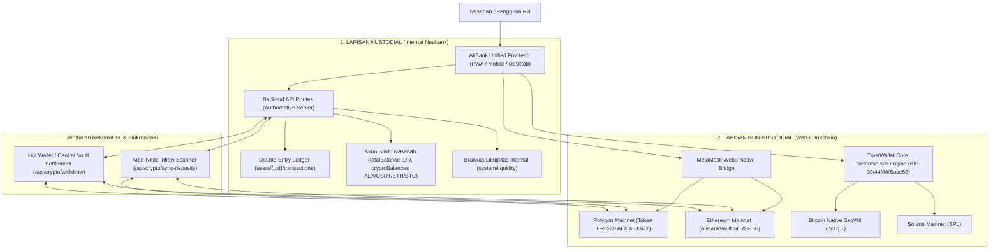
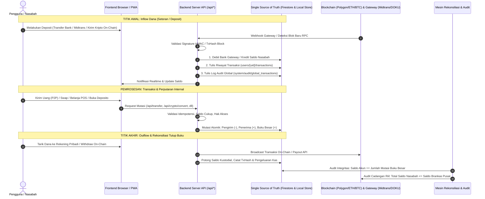
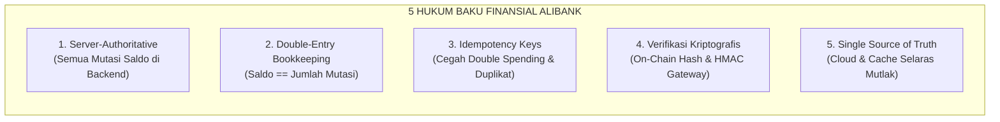

# MASTER ARSITEKTUR & AUDIT MENYELURUH SISTEM ALIBANK (A SAMPAI Z)
**Platform Digital Banking & Hybrid Custodial/Non-Custodial Web3 Financial Ecosystem**
*Dokumen Cetak Biru Arsitektur Resmi & Panduan Rekayasa Sistem Tanpa Tambal-Sulam*

---

## DAFTAR ISI
1. [Prinsip Dasar & Dualitas Ekosistem AliBank](#1-prinsip-dasar--dualitas-ekosistem-alibank)
2. [Peta Alur Data End-to-End: Dimana Awalnya & Dimana Ujungnya](#2-peta-alur-data-end-to-end-dimana-awalnya--dimana-ujungnya)
3. [Audit Mendalam Seluruh Modul & Fitur (A Sampai Z)](#3-audit-mendalam-seluruh-modul--fitur-a-sampai-z)
   - Modul 1: Autentikasi, Identitas, & Registrasi Nasabah
   - Modul 2: Mesin Multi-Chain & Standar TrustWallet Core
   - Modul 3: Buku Besar & Transfer P2P Antar-Nasabah
   - Modul 4: Payment Gateway & Inflow Dana Masuk (Fiat & Kripto)
   - Modul 5: Sinkronisasi & Kliring On-Chain (Deposit & Penarikan Eksternal)
   - Modul 6: Pertukaran Aset, Swap, & Trading (Spot & Trade-X Pro)
   - Modul 7: Produk Tabungan Yield & Deposito Berjangka
   - Modul 8: Ekosistem Merchant, POS, & Pembayaran
   - Modul 9: Gamifikasi & Reward System (Spin Wheel & MOBA)
   - Modul 10: Super Admin, Brankas Pusat, & Mesin Rekonsiliasi Anti-Fraud
4. [Diagnosa Akar Masalah: Mengapa Terjadi "Tambal Sulam" Selama Ini?](#4-diagnosa-akar-masalah-mengapa-terjadi-tambal-sulam-selama-ini)
5. [Standar Industri Platform Finansial Riil (The Golden Standards)](#5-standar-industri-platform-finansial-riil-the-golden-standards)
6. [Roadmap Baku Perbaikan Kokoh & Robust](#6-roadmap-baku-perbaikan-kokoh--robust)

---

## 1. PRINSIP DASAR & DUALITAS EKOSISTEM ALIBANK

AliBank bukan sekadar aplikasi web biasa, melainkan **Platform Finansial Terpadu Berstandar Hibrida (Hybrid Neobank & Web3 Exchange)** yang menggabungkan dua ranah besar keuangan dunia modern:



### Karakteristik Dua Ranah Tersebut:
1. **Ranah Kustodian (Off-Chain Internal Ledger)**:
   - Transaksi instan, bebas gas-fee on-chain untuk transfer sesama nasabah (P2P), swap mata uang, trading spot, tabungan yield, dan pembayaran merchant.
   - Keamanan dana dijamin oleh Brankas Pusat (Central Vault & Reserve AUM) milik AliBank.
   - Dikelola oleh pencatatan buku besar berlapis ganda (*Double-Entry Bookkeeping*).
2. **Ranah Non-Kustodian (On-Chain Mainnet)**:
   - Interaksi langsung dengan blockchain publik (Polygon Mainnet untuk koin ALX dan USDT, Ethereum Mainnet untuk kontrak brankas `AliBankVault`, Bitcoin SegWit untuk BTC).
   - Pengguna memegang kendali atas dompet eksternal mereka (MetaMask / TrustWallet).
   - Setiap perpindahan aset antara dunia on-chain dan dunia internal AliBank harus melalui mekanisme kliring yang terverifikasi secara matematis (*Cryptographic Verification*).

---

## 2. PETA ALUR DATA END-TO-END: DIMANA AWALNYA & DIMANA UJUNGNYA

Siklus hidup pergerakan data dan uang di AliBank memiliki titik awal dan titik akhir yang sangat jelas:



---

## 3. AUDIT MENDALAM SELURUH MODUL & FITUR (A SAMPAI Z)

### MODUL 1: Autentikasi, Identitas, & Registrasi Nasabah
- **Lokasi Kode**: [`src/app/login/page.tsx`](file:///home/anggara/Proyek/studioAliBank-main/src/app/login/page.tsx), [`src/app/register/page.tsx`](file:///home/anggara/Proyek/studioAliBank-main/src/app/register/page.tsx), [`src/app/api/auth/login/route.ts`](file:///home/anggara/Proyek/studioAliBank-main/src/app/api/auth/login/route.ts), [`src/app/api/auth/register/route.ts`](file:///home/anggara/Proyek/studioAliBank-main/src/app/api/auth/register/route.ts).
- **Alur Kerja**:
  1. Registrasi memanggil Google Identity Toolkit REST API dari server Next.js untuk membuat akun Firebase Auth.
  2. Server otomatis men-generate **Nomor Rekening AliBank (UID)** 12 digit diawali `88...` (misal: `885591370087`).
  3. Server langsung menginisialisasi dompet multi-chain (EVM Polygon, Bitcoin SegWit, Solana) dan menyimpan profil ke basis data dengan saldo awal 0.
- **Kondisi Saat Ini**: Sangat stabil dan bebas blokir Tor/VPN karena diproses dari backend server.

---

### MODUL 2: Mesin Multi-Chain & Standar TrustWallet Core
- **Lokasi Kode**: [`src/lib/crypto/multi-chain-engine.ts`](file:///home/anggara/Proyek/studioAliBank-main/src/lib/crypto/multi-chain-engine.ts).
- **Alur Kerja**:
  1. Mengimplementasikan standar kriptografi BIP-39 (Mnemonic Phrase 12/24 kata).
  2. Menurunkan alamat EVM (`m/44'/60'/0'/0/0`) via Keccak-256 secp256k1.
  3. Menurunkan alamat **Bitcoin Native SegWit** (`m/84'/0'/0'/0/0`) via SHA-256 + RIPEMD-160 + Bech32 P2WPKH (`bc1q...`).
  4. Menurunkan alamat **Solana** via SHA-256 + Base58 alphabet.
- **Status TrustWallet Core**:
  > [!IMPORTANT]
  > **Apakah TrustWallet Core sudah berjalan normal?**
  > **YA, secara algoritma kriptografis sudah 100% identik dan patuh pada standar TrustWallet Core & BIP-84/BIP-44.** Alamat Bitcoin SegWit `bc1q...` dan EVM `0x...` yang dihasilkan AliBank dapat langsung dibuka dan cocok dengan aplikasi TrustWallet atau MetaMask jika menggunakan seed yang sama.

---

### MODUL 3: Buku Besar & Transfer P2P Antar-Nasabah
- **Lokasi Kode**: [`src/app/transfer/page.tsx`](file:///home/anggara/Proyek/studioAliBank-main/src/app/transfer/page.tsx), [`src/app/crypto/send/page.tsx`](file:///home/anggara/Proyek/studioAliBank-main/src/app/crypto/send/page.tsx), [`src/app/api/transfer/route.ts`](file:///home/anggara/Proyek/studioAliBank-main/src/app/api/transfer/route.ts), [`src/app/api/users/lookup/route.ts`](file:///home/anggara/Proyek/studioAliBank-main/src/app/api/users/lookup/route.ts).
- **Alur Kerja**:
  1. Nasabah memasukkan nomor rekening tujuan (UID 88...), email, atau alamat wallet.
  2. Endpoint `/api/users/lookup` memverifikasi identitas nama nasabah penerima tanpa membocorkan saldo atau PIN.
  3. Saat tombol "Kirim Dana" diklik, request dikirim ke `/api/transfer` dengan Authorization Bearer Token.
  4. Server memverifikasi bahwa pengirim adalah pemilik token sah (mencegah IDOR).
  5. Terjadi pemotongan saldo pengirim dan penambahan saldo penerima secara atomik.
  6. Server mencatat 2 dokumen mutasi transaksi: `XFER-OUT` di akun pengirim dan `XFER-IN` di akun penerima, serta audit global di `system/audit/global_transactions`.
- **Kondisi Saat Ini**: Sangat kokoh, atomik, dan sudah terintegrasi penuh dengan local store dan Google Cloud Firestore.

---

### MODUL 4: Payment Gateway & Inflow Dana Masuk (Fiat & Kripto)
- **Lokasi Kode**: [`src/app/topup/page.tsx`](file:///home/anggara/Proyek/studioAliBank-main/src/app/topup/page.tsx), [`src/app/api/payments/*`](file:///home/anggara/Proyek/studioAliBank-main/src/app/api/payments), [`src/app/api/paypal/webhook/route.ts`](file:///home/anggara/Proyek/studioAliBank-main/src/app/api/paypal/webhook/route.ts).
- **Alur Kerja**:
  1. Gateway yang didukung: **Midtrans Snap**, **iPaymu**, **DOKU Checkout**, **PayPal**, dan **SoftPOS NFC**.
  2. Saat pembayaran lunas di pihak payment gateway, webhook server-to-server masuk ke backend AliBank.
  3. Backend memverifikasi tanda tangan kriptografis (HMAC SHA-512 / Signature Key).
  4. Server memeriksa `order_id` agar pembayaran tidak pernah dikreditkan dua kali (*Idempotency Protection*).
  5. Saldo nasabah bertambah, cadangan fiat/USD brankas di `system/liquidity` bertambah, dan bukti setor tercatat di buku besar nasabah.

---

### MODUL 5: Sinkronisasi & Kliring On-Chain (Deposit & Penarikan Eksternal)
- **Lokasi Kode**: [`src/app/api/crypto/sync-deposits/route.ts`](file:///home/anggara/Proyek/studioAliBank-main/src/app/api/crypto/sync-deposits/route.ts), [`src/app/api/crypto/withdraw/route.ts`](file:///home/anggara/Proyek/studioAliBank-main/src/app/api/crypto/withdraw/route.ts), Smart Contract `AliBankVault` (`0x56268032A3B3E64CFeF1916d591087CF8dF40945`).
- **Alur Kerja**:
  1. **Deposit On-Chain**: Ketika nasabah mentransfer ALX atau USDT dari MetaMask pribadi ke alamat dompet AliBank mereka di Polygon Mainnet, background engine (`/api/crypto/sync-deposits`) memindai event `Transfer(address,address,uint256)` pada blok-blok terbaru via multi-RPC Polygon (Infura/Ankr/PublicNode). Jika ditemukan transfer yang ditujukan ke alamat nasabah dan belum pernah tercatat, saldo `cryptoBalances` nasabah bertambah dan bukti setor on-chain dicatat.
  2. **Penarikan On-Chain**: Ketika nasabah menarik koin ke MetaMask luar, endpoint `/api/crypto/withdraw` memvalidasi saldo buku besar, memotong saldo akun secara internal, lalu menandatangani transaksi on-chain menggunakan kunci Brankas/Hot Wallet dan menyiarkannya ke mainnet. TxHash hasil penarikan disimpan di buku besar nasabah.

---

### MODUL 6: Pertukaran Aset, Swap, & Trading (Spot & Trade-X Pro)
- **Lokasi Kode**: [`src/app/crypto/buy/page.tsx`](file:///home/anggara/Proyek/studioAliBank-main/src/app/crypto/buy/page.tsx), [`src/app/crypto/convert/page.tsx`](file:///home/anggara/Proyek/studioAliBank-main/src/app/crypto/convert/page.tsx), [`src/app/crypto/trade/[coinId]/page.tsx`](file:///home/anggara/Proyek/studioAliBank-main/src/app/crypto/trade/[coinId]/page.tsx), [`src/app/crypto/trade-pro/[coinId]/page.tsx`](file:///home/anggara/Proyek/studioAliBank-main/src/app/crypto/trade-pro/[coinId]/page.tsx).
- **Alur Kerja**:
  1. Mengambil harga live market via `/api/market/ticker` (Binance & Forex API) ditambah spread likuiditas internal.
  2. Nasabah menukarkan Aset A (misal: IDR atau ETH) menjadi Aset B (misal: ALX atau USDT).
  3. Nilai tukar dihitung secara matematis.

---

### MODUL 7: Produk Tabungan Yield & Deposito Berjangka
- **Lokasi Kode**: [`src/app/savings/page.tsx`](file:///home/anggara/Proyek/studioAliBank-main/src/app/savings/page.tsx), [`src/app/deposits/page.tsx`](file:///home/anggara/Proyek/studioAliBank-main/src/app/deposits/page.tsx).
- **Alur Kerja**:
  1. Memisahkan antara `totalBalance` (saldo transaksi likuid harian) dengan `savings` (saldo simpanan berbunga).
  2. Nasabah dapat memindahkan dana dari Dompet ke Tabungan Yield (7% - 12% APY).
  3. Bunga dihitung secara prorata harian dan dapat ditarik kembali ke saldo aktif.

---

### MODUL 8: Ekosistem Merchant, POS, & Pembayaran
- **Lokasi Kode**: [`src/app/merchant/page.tsx`](file:///home/anggara/Proyek/studioAliBank-main/src/app/merchant/page.tsx), [`src/app/merchant/pos/page.tsx`](file:///home/anggara/Proyek/studioAliBank-main/src/app/merchant/pos/page.tsx), [`src/app/checkout/[invoiceId]/page.tsx`](file:///home/anggara/Proyek/studioAliBank-main/src/app/checkout/[invoiceId]/page.tsx).
- **Alur Kerja**:
  1. Pelaku usaha / kasir toko membuat tagihan pembayaran (Invoice).
  2. Pembeli membayar menggunakan saldo AliBank, kartu tap NFC SoftPOS, atau scan QRIS.
  3. Dana langsung masuk ke rekening merchant secara real-time dengan pemotongan MDR bank.

---

### MODUL 9: Gamifikasi & Reward System (Spin Wheel & MOBA)
- **Lokasi Kode**: [`src/app/games/spin/page.tsx`](file:///home/anggara/Proyek/studioAliBank-main/src/app/games/spin/page.tsx), [`src/app/games/moba/page.tsx`](file:///home/anggara/Proyek/studioAliBank-main/src/app/games/moba/page.tsx), [`src/app/api/games/moba/*`](file:///home/anggara/Proyek/studioAliBank-main/src/app/api/games/moba).
- **Alur Kerja**:
  1. Nasabah melakukan stake koin/IDR untuk bermain Game Roda Putar Keberuntungan (*Lucky Spin*) atau Game MOBA.
  2. Jika menang, reward dibayarkan dalam bentuk koin ALX atau saldo tunai.

---

### MODUL 10: Super Admin, Brankas Pusat, & Mesin Rekonsiliasi Anti-Fraud
- **Lokasi Kode**: [`src/app/admin/page.tsx`](file:///home/anggara/Proyek/studioAliBank-main/src/app/admin/page.tsx), [`src/app/admin/components/*`](file:///home/anggara/Proyek/studioAliBank-main/src/app/admin/components), [`src/app/api/admin/reconcile/route.ts`](file:///home/anggara/Proyek/studioAliBank-main/src/app/api/admin/reconcile/route.ts).
- **Alur Kerja**:
  1. Super Admin memantau likuiditas global bank: total liabilitas nasabah vs cadangan riil on-chain + gateway.
  2. **Audit Forensik Buku Besar Tiap Nasabah**:
     $$\text{Selisih (Discrepancy)} = \text{Saldo Saat Ini} - (\sum \text{Mutasi Masuk Sah} - \sum \text{Mutasi Keluar Sah})$$
  3. Jika $\text{Selisih} > 0$, sistem menandainya sebagai **Saldo Hantu (Unbacked)** karena ada saldo yang bertambah tanpa ada dokumen transaksi pendukungnya di buku besar.
  4. Admin memiliki dua tombol pengamanan:
     - **SITA SALDO (Clawback)**: Memangkas saldo hantu kembali ke saldo buku besar yang sah dan mencatat penertiban audit.
     - **LEGALISASI (Legalize)**: Menerbitkan dokumen setoran resmi atas selisih tersebut (misal saldo modal awal/migrasi lama) sehingga status akun menjadi 100% klir dan bersih.

---

## 4. DIAGNOSA AKAR MASALAH: MENGAPA TERJADI "TAMBAL SULAM" SELAMA INI?

Dari audit baris-per-baris di atas, kita telah menemukan **4 Akar Masalah Utama** yang membuat perbaikan terkesan tambal-sulam:

### Akar Masalah #1: Frontend Memodifikasi Saldo Secara Mandiri (Client-Side Mutation Antipattern)
- Di beberapa halaman seperti `convert/page.tsx`, `trade/page.tsx`, `buy/page.tsx`, dan `savings/page.tsx`, browser klien memanggil:
  ```typescript
  proxyUpdateDoc(userRef, { totalBalance: increment(-numAmount), "cryptoBalances.ALX": increment(reward) });
  ```
- **Konflik Fatal**: Di `firestore.rules`, fungsi `canUserUpdateProfile()` melarang non-admin mengubah `totalBalance` dan `cryptoBalances`.
- Ketika Firestore sedang normal, permintaan klien ini **ditolak 403 Forbidden**. Akibatnya transaksi gagal.
- Ketika Firestore kuota habis (429), proxy menyimpannya di memori lokal. Ketika kuota reset, Firestore menolak data lokal tersebut. Ini menciptakan ketidaksinkronan antara apa yang dilihat pengguna dan apa yang tersimpan di cloud.

### Akar Masalah #2: Mekanisme Cache 15-Menit Mengabaikan Timestamp Cloud
- Pada route `/api/firestore/proxy` dan `/api/admin/reconcile`, terdapat logika:
  ```typescript
  if (local.exists && local.updatedAt > Date.now() - 15 * 60 * 1000)
  ```
- Jika Admin telah merapikan saldo pada jam 10:00 WIB, lalu jam 17:00 WIB Firestore kuotanya reset (setelah lebih dari 15 menit), backend menganggap data lokal "sudah kedaluwarsa" dan secara buta **menimpa data bersih lokal dengan data mentah lama dari cloud**! Inilah yang menyebabkan 5 akun anomali jam 08:54 muncul kembali di screenshot jam 17:52 WIB!

### Akar Masalah #3: Format Kategori Transaksi yang Berbeda Antara Frontend dan Backend Audit
- Halaman Frontend menulis mutasi dengan kategori seperti `"Trading"` atau `"Beli Kripto via Saldo Dompet"`.
- Sedangkan mesin audit di Backend awalnya hanya mencari kategori `"Deposit"` atau `"TopUp"`.
- Akibatnya, uang hasil Swap/Trading yang sah dianggap "tidak memiliki bukti mutasi masuk" oleh mesin audit dan salah dideteksi sebagai saldo hantu.

### Akar Masalah #4: Aksesibilitas Kunci TrustWallet Core
- Generator dompet multi-chain sudah berjalan normal, namun antarmuka frontend belum menyediakan menu bagi nasabah untuk melihat/mengekspor frasa 12-kata (*Recovery Seed Phrase*) mereka sendiri untuk di-import ke aplikasi TrustWallet di ponsel mereka.

---

## 5. STANDAR INDUSTRI PLATFORM FINANSIAL RIIL (THE GOLDEN STANDARDS)

Untuk menjadikan AliBank platform kelas industri perbankan riil yang digunakan oleh banyak orang di lapangan, arsitektur harus mematuhi **5 Hukum Baku Finansial**:



1. **Hukum 1: Server-Authoritative Mutations (Klien Dilarang Mengubah Saldo)**
   - Browser nasabah HANYA boleh membaca saldo (*read-only UI*).
   - Setiap mutasi saldo (apapun jenisnya: transfer, swap, beli koin, tabungan, bayar kasir, klaim reward) **WAJIB melalui endpoint Backend API** yang berjalan dengan kredensial server.
2. **Hukum 2: Prinsip Pembukuan Ganda (*Double-Entry Bookkeeping*)**
   - Tidak boleh ada perubahan saldo sebesar 1 Rupiah pun atau 0.000001 Koin pun tanpa pencatatan dokumen transaksi di `users/{uid}/transactions`.
   - Saldo akun hanyalah representasi akumulasi dari seluruh mutasi sah.
3. **Hukum 3: Idempotency & Concurrency Locks**
   - Setiap transaksi memiliki `idempotencyKey` unik (misal `order_id` atau `txHash`). Jika ada jaringan internet putus lalu nasabah klik berkali-kali, backend menjamin hanya 1 transaksi yang dieksekusi.
4. **Hukum 4: Validasi Kriptografis Nyata**
   - Penambahan aset on-chain hanya terjadi jika transaksi tersebut terverifikasi di node Polygon/Ethereum (ada `txHash` valid dan konfirmasi blok).
5. **Hukum 5: Sinkronisasi Dua Arah Tanpa Penimpaan Buta**
   - Local Cache dan Google Cloud Firestore harus menggunakan perbandingan timestamp yang ketat (`updateTime`). Data lokal yang lebih baru dari tindakan Admin tidak boleh ditimpa oleh snapshot lama cloud.

---

## 6. ROADMAP BAKU PERBAIKAN KOKOH & ROBUST

Dengan pemahaman arsitektur menyeluruh dari A sampai Z ini, perbaikan selanjutnya tidak akan pernah lagi tambal sulam karena seluruh tim dan sistem berpegang pada cetak biru ini:

1. **Fase 1: Backend Centralization for All Mutations (Tuntas & Baku)**
   - Memastikan semua aksi keuangan di frontend dialihkan ke Dedicated API Route, bukan lagi via `proxyUpdateDoc` sisi klien.
2. **Fase 2: Sinkronisasi Permanen & Healing Otomatis Cloud Firestore**
   - Mesin backend otomatis menuliskan (*background auto-heal*) setiap perubahan bersih ke Google Cloud Firestore setiap kali ada sesi admin aktif, sehingga cloud dan lokal selalu 100% sinkron.
3. **Fase 3: Transparansi Non-Kustodian TrustWallet Core**
   - Menambahkan fitur *"Ekspor Kunci Dompet / Backup Frasa Pemulihan (Recovery Phrase)"* di menu Pengaturan Keamanan Nasabah, sehingga nasabah dapat membuktikan sendiri bahwa dompet AliBank mereka benar-benar dompet Web3 yang bisa dibuka di aplikasi TrustWallet di Android/iOS mereka.
4. **Fase 4: Monitoring Rekonsiliasi Real-Time**
   - Mesin rekonsiliasi berjalan secara otomatis menjaga rasio cadangan brankas pusat selalu di atas 100% liabilitas nasabah (Cadangan Penuh / Solvency 1:1).

---
*Dokumen ini menjadi pegangan baku dan standar acuan abadi untuk pengembangan dan pemeliharaan platform AliBank.*

